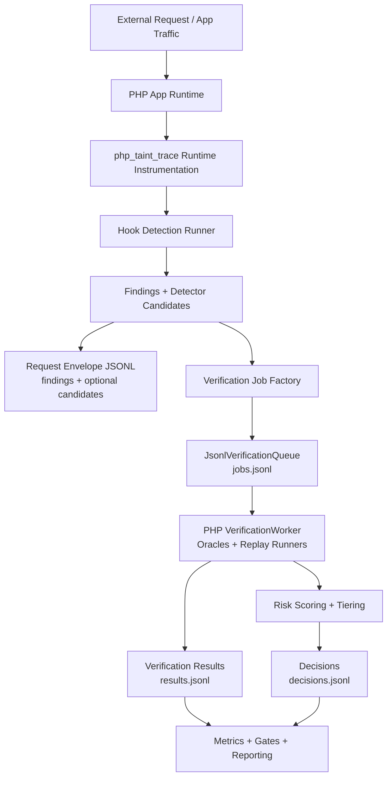

# End-to-End Verification Flow

## Notes

- `php_taint_trace` handles request-time detection, candidate creation, and queueing.
- Verification runs through the native PHP worker path.
- Sink oracles (RCE/SSRF/SQLi/File/XSS/IDOR/XXE) drive confirmation and false-positive reduction.
