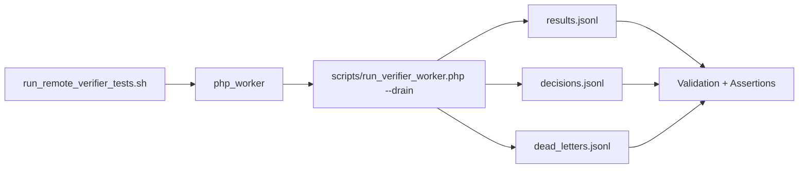

# Verification Execution Mode

## Notes

- The remote verifier test harness is now worker-only (`php_worker`).
- DBGp batch backend is intentionally removed from this path to avoid session-plumbing timeouts and replay instability.
- Throughput and accuracy are improved by focusing on deterministic oracle replay + scoring in one backend.
