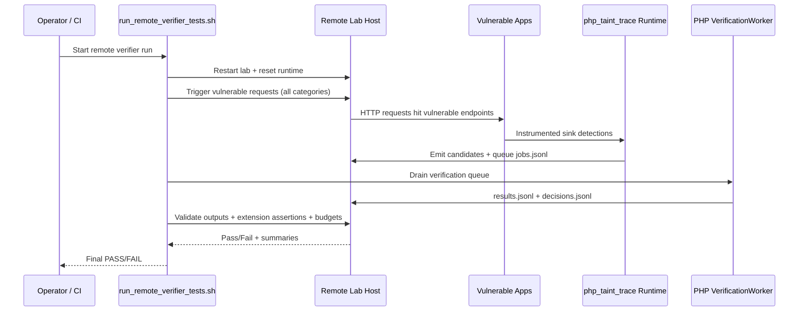
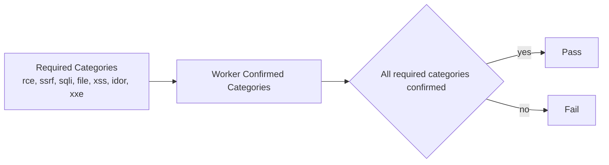

# Remote E2E Orchestration and Parity

## Notes

- Remote orchestration is worker-only.
- Daemon deployment/smoke automation:
  - `scripts/provision_remote_node22.sh`
  - `scripts/deploy_remote_daemons.sh`
  - `scripts/run_remote_daemon_smoke.sh`
  - `scripts/run_remote_daemon_full_stack_e2e.sh`
- Full-stack daemon E2E required-category contract:
  - Defaults to `rce,ssrf,sqli,file,xss,idor,xxe`.
  - Override supported via `--required-categories CSV` for targeted runs.
- Current validated remote status (2026-04-25):
  - `deploy_remote_daemons.sh --ui-host 0.0.0.0` succeeds (Node 22 provisioning guard runs by default).
  - `run_remote_daemon_smoke.sh` passes end-to-end (health, issue projection, triage persistence).
  - `run_remote_daemon_full_stack_e2e.sh` validates real sink-triggered `php_taint_trace -> verifier worker -> UI daemon` flow.
  - Re-validated on 2026-04-26 with `--extension-profile extended_all`:
    - queued verifier jobs observed from real sink triggers,
    - `scripts/run_verifier_worker.php --drain` produced decisions,
    - worker decisions covered required categories (`file,idor,rce,sqli,ssrf,xss,xxe`),
    - UI API projected matching candidate IDs.
  - External health checks confirmed:
    - `http://192.0.2.10:19120/health`
