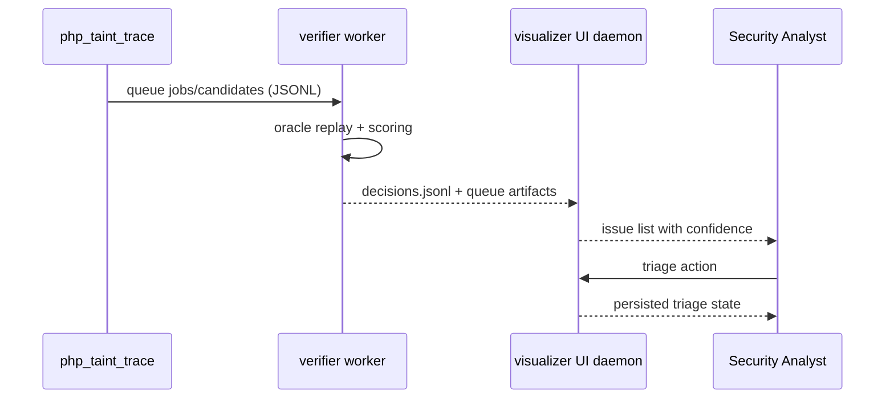

# Daemon Cooperative Architecture

```mermaid
flowchart LR
    Fuzzer[Node.js Fuzzer / Traffic Generator] --> Target[Remote PHP App + php_taint_trace]
    Target --> Artifacts[Runtime JSONL Artifacts\nfindings/candidates/jobs]
    Artifacts --> Worker[php_taint_trace verifier worker\n(remote host)]
    Worker --> Decisions[results.jsonl + decisions.jsonl]
    Decisions --> UI[vulnerability_visualizer_ui_daemon\n(central host)]
    UI --> Analyst[Human Analyst Triage\naffirmed/dismissed/needs_review]
```



## Notes

- Verifier execution is worker-based and runs close to the instrumented PHP runtime.
- UI daemon is intended to run centrally and aggregate worker artifacts.
- This separation keeps runtime verification close to targets and analyst workflows centralized without an intermediate bridge process.
